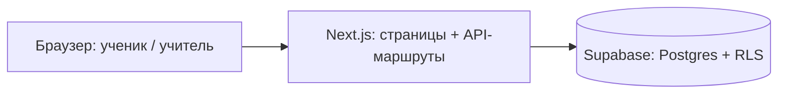

# ARCHITECTURE.md

Архитектура: схема, структура папок, принципы, связь документации и шагов.

## Схема


Роли:
- **Ученик**: вход по коду класса и личному коду, решает задачи, проходит тесты.
- **Учитель**: `/teacher`, секретный код, видит итоги, коды, экспорт.

Поток ответа:
```
ответ ученика -> POST /api/answer -> проверка сессии и лимита
  -> сверка с эталоном (только на сервере) -> запись попытки в Supabase
  -> вердикт клиенту (correct / incorrect / invalid_format / teacher)
```
Эталоны не покидают сервер. Браузер не обращается к базе: сервер читает задачи из `tasks_public` ключом `SUPABASE_SERVICE_ROLE_KEY` (`lib/tasks.ts`, только серверный код).

## Структура папок (предлагаемая)
```
app/            страницы и API-маршруты (app/api/...)
components/     UI-компоненты
lib/            серверная и общая логика (supabase, сессии, проверка)
messages/       kk.json, ru.json — все тексты интерфейса
supabase/migrations/   миграции схемы
docs/           при необходимости
AGENTS.md DESIGN.md BACKEND.md ARCHITECTURE.md ROADMAP.md SESSIONS.md   (корень)
```

## Принципы
- Минимум зависимостей, ничего лишнего.
- Тексты только в `messages/*.json`.
- Секретов в коде нет; только переменные окружения.
- Схема меняется только миграциями.

## Соглашения об именах
- Файлы компонентов: `PascalCase.tsx`; остальные: `kebab-case.ts`.
- Таблицы и поля БД: `snake_case`; переменные и функции: `camelCase`.
- Ключи переводов: `раздел.смысл` (например `task.submit`), одинаковые в kk и ru.

## Локальный запуск
Нужны Node.js 22 и npm.

```bash
npm install
cp .env.example .env.local
npm run dev
```

В `.env.local` заполните `NEXT_PUBLIC_SUPABASE_URL`, `SUPABASE_SERVICE_ROLE_KEY` и `SESSION_SECRET`, каждое значение одной строкой. Сайт откроется на http://localhost:3000.

Проверка и продакшен-сборка:

```bash
npm run lint
npm run build
npm run start
```

## Деплой и пилот

### Деплой
- Vercel: проект `diplom-practicum`, репозиторий `isatayfirst/diplom-practicum`, ветка `main` (каждый пуш в `main` собирается и выходит в Production). Адрес: `https://diplom-practicum.vercel.app`. Регион функций `fra1` (рядом с Supabase `eu-central-1`). Защита адреса входом Vercel выключена: сайт открыт всем.
- Переменные окружения (только Production, значения вводятся в панели Vercel, `Sensitive` у секретных): `NEXT_PUBLIC_SUPABASE_URL`, `SUPABASE_SERVICE_ROLE_KEY`, `SESSION_SECRET`, `TEACHER_SECRET_CODE`. `NEXT_PUBLIC_SUPABASE_ANON_KEY` не нужна. Секретам не давать префикс `NEXT_PUBLIC_`. После смены переменной нужен Redeploy.
- Значения на Vercel отличаются от локальных. Смена `TEACHER_SECRET_CODE` гасит все выданные сессии учителя, смена `SESSION_SECRET` гасит все сессии.
- Ограничения: лимиты (30 ответов в минуту, 5 неверных кодов учителя за 15 минут) считаются в памяти экземпляра, у каждого свой счётчик; у `/login` ученика лимита нет (ROADMAP, вопрос 14).

### Порядок подготовки пилота
1. Убрать тестовые данные (раздел ниже), решение о удалении принимает автор.
2. Создать классы SQL-запросом в Supabase (SQL editor). Код класса: латиница и цифры, `study_group`: `experimental` или `control`:
   ```sql
   insert into classes (code, label, study_group, active) values
     ('8A', '8A эксперим.', 'experimental', true),
     ('8B', '8B бақылау', 'control', true);
   ```
3. Открыть `/teacher/login` на публичном адресе, ввести секретный код учителя (из менеджера паролей, не из чата).
4. Открыть `/teacher/students`, выбрать класс, добавлять учеников кнопкой «Нөмір қосу» (до 40 на класс). Сайт сам генерирует личные коды из 5 знаков.
5. Распечатать список «номер — код» (печатная версия страницы учеников) и раздать ученикам по номеру. Имён в системе нет.
6. Настоящие вопросы тестов внести в `tests`, `test_questions`, `test_question_keys` (открытый вопрос 9), затем открыть предтест классу на `/teacher/tests` (переключатель с подтверждением). Итоговый тест открывать в конце.
7. В день пилота: ученики входят на `/login` (код класса и личный код), опытный класс решает задачи и тесты, контрольный проходит только тесты.
8. По окончании: `/teacher/tests` → блок «Деректер экспорты» → три CSV (попытки, результаты тестов, ученики) по классу; открывать в Excel (UTF-8 с BOM, разделитель `;`). Оценить выводы на `/teacher`.
9. Выйти из кабинета («Шығу»).

### Тестовые данные в живой базе
Не удаляются без решения автора. На 2026-11-11: 5 классов, 14 учеников, 12 попыток, 3 оценки (`text_scores`), 4 вопроса теста, 4 ключа, 2 строки `class_tests`, 14 ответов теста, 4 завершения.
- Классы: `S8EXP` (9 учеников, 4 исключены), `S8CTL` (3), `S8EMPTY` (0), `S8INJ` (1; метка с формулой, для проверки CSV), `1` (ученик №1, личный код `11111`, тестовый вход автора, слабый код).
- Вопросы теста «S8 сұрақ …» и «S8 сұрақ итог 1» лежат в настоящих строках `tests` (2 строки `tests` остаются, это сами тесты). Пока они в базе и тест открыт классу, ученики его увидят.
- Как убрать (порядок важен из-за внешних ключей; перед удалением проверить, что нет настоящих классов среди перечисленных кодов):
  ```sql
  -- 1. ответы и завершения тестов тестовых учеников
  delete from test_answers where student_id in (select s.id from students s join classes c on c.id = s.class_id where c.code in ('S8EXP','S8CTL','S8EMPTY','S8INJ','1'));
  delete from test_sessions where student_id in (select s.id from students s join classes c on c.id = s.class_id where c.code in ('S8EXP','S8CTL','S8EMPTY','S8INJ','1'));
  -- 2. оценки и попытки
  delete from text_scores where attempt_id in (select a.id from attempts a join students s on s.id = a.student_id join classes c on c.id = s.class_id where c.code in ('S8EXP','S8CTL','S8EMPTY','S8INJ','1'));
  delete from attempts where student_id in (select s.id from students s join classes c on c.id = s.class_id where c.code in ('S8EXP','S8CTL','S8EMPTY','S8INJ','1'));
  -- 3. открытие тестов классам, ученики, классы
  delete from class_tests where class_id in (select id from classes where code in ('S8EXP','S8CTL','S8EMPTY','S8INJ','1'));
  delete from students where class_id in (select id from classes where code in ('S8EXP','S8CTL','S8EMPTY','S8INJ','1'));
  delete from classes where code in ('S8EXP','S8CTL','S8EMPTY','S8INJ','1');
  -- 4. условные вопросы тестов: сначала посмотреть список
  select id, statement_kk from test_questions order by statement_kk;
  -- затем (после проверки, что все строки с префиксом «S8 »; это условные вопросы):
  -- delete from test_question_keys where question_id in (select id from test_questions where statement_kk like 'S8 %');
  -- delete from test_questions where statement_kk like 'S8 %';
  ```
  Имена колонок сверены со схемой базы 2026-11-11.

## Документация и шаги
Файлы документации лежат в корне. Работа идёт по шагам из ROADMAP.md, правила сессий — в AGENTS.md, история — в SESSIONS.md.
