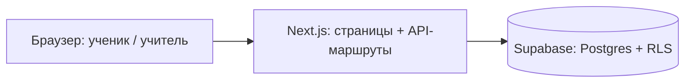

# ARCHITECTURE.md

Архитектура: схема, структура папок, принципы, связь документации и шагов.

## Схема


Роли:
- **Ученик**: вход по коду класса и личному коду, решает задачи, проходит тесты.
- **Учитель**: `/teacher`, секретный код, видит итоги, коды, экспорт.

Поток ответа:
```
ответ ученика -> POST /api/answer -> проверка сессии и лимита
  -> сверка с эталоном (только на сервере) -> запись попытки в Supabase
  -> вердикт клиенту (correct / incorrect / invalid_format / teacher)
```
Эталоны не покидают сервер. Браузер не обращается к базе: сервер читает задачи из `tasks_public` ключом `SUPABASE_SERVICE_ROLE_KEY` (`lib/tasks.ts`, только серверный код).

## Структура папок (предлагаемая)
```
app/            страницы и API-маршруты (app/api/...)
components/     UI-компоненты
lib/            серверная и общая логика (supabase, сессии, проверка)
messages/       kk.json, ru.json — все тексты интерфейса
supabase/migrations/   миграции схемы
docs/           при необходимости
AGENTS.md DESIGN.md BACKEND.md ARCHITECTURE.md ROADMAP.md SESSIONS.md   (корень)
```

## Принципы
- Минимум зависимостей, ничего лишнего.
- Тексты только в `messages/*.json`; язык из cookie `lang` (`kk` по умолчанию), сервер `getT()`, браузер `useT()`.
- Секретов в коде нет; только переменные окружения.
- Схема меняется только миграциями.

## Соглашения об именах
- Файлы компонентов: `PascalCase.tsx`; остальные: `kebab-case.ts`.
- Таблицы и поля БД: `snake_case`; переменные и функции: `camelCase`.
- Ключи переводов: `раздел.смысл` (например `task.submit`), одинаковые в kk и ru.

## Локальный запуск
Нужны Node.js 22 и npm.

```bash
npm install
cp .env.example .env.local
npm run dev
```

В `.env.local` заполните `NEXT_PUBLIC_SUPABASE_URL`, `SUPABASE_SERVICE_ROLE_KEY` и `SESSION_SECRET`, каждое значение одной строкой. Сайт откроется на http://localhost:3000.

Проверка и продакшен-сборка:

```bash
npm run lint
npm run build
npm run start
```

## Документация и шаги
Файлы документации лежат в корне. Работа идёт по шагам из ROADMAP.md, правила сессий — в AGENTS.md, история — в SESSIONS.md.
